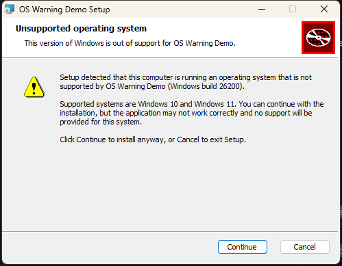

# OsWarningDemo – WiX v5 "unsupported OS" warning example

Shows how to warn the user, **without blocking the install**, when the app is installed on
something other than Windows 10 or Windows 11.

```
OsWarningDemo.slnx
src/
  OsWarningDemo.App/          WinForms app (.NET 8) – shows a dismissible warning banner at runtime
  OsWarningDemo.Installer/    WiX v5 SDK project – shows a warning dialog before the setup wizard
```

## Build

```bash
dotnet build OsWarningDemo.slnx -c Release
```

The MSI is written to `src/OsWarningDemo.Installer/bin/Release/OsWarningDemo.msi`.
No WiX install is needed; the `WixToolset.Sdk` and `WixToolset.UI.wixext` packages come from NuGet.

## 1. Installer warning (Package.wxs)



**Detection.** Windows Installer's `VersionNT` / `WindowsBuild` properties are version-lied on
Windows 10/11 (they report Windows 8.1), so the package reads the registry instead:

| Property | Source | Meaning |
|---|---|---|
| `WINDOWS_MAJOR_VERSION` | `HKLM\SOFTWARE\Microsoft\Windows NT\CurrentVersion\CurrentMajorVersionNumber` | `#10` on Windows 10 and 11; missing on 8.1 and older |
| `WINDOWS_BUILD` | `...\CurrentVersion\CurrentBuildNumber` | shown in the message (≥ 22000 = Windows 11) |
| `MsiNTProductType` | built-in MSI property | `1` = client; servers (2016+ also report major 10) are 2 or 3 |

A `SetProperty` action then sets `OS_UNSUPPORTED=1` when the OS is not a Windows 10/11 client.

**Warning, not a block.** There is intentionally no `<Launch>` condition. Instead a custom
`UnsupportedOsDlg` is scheduled in `InstallUISequence` right after `CostFinalize` (so before
`WelcomeDlg`) with the condition `OS_UNSUPPORTED AND NOT Installed`:

- **Continue** → `EndDialog Return`: the normal WixUI_InstallDir wizard continues.
- **Cancel** → the standard WixUI cancel confirmation.

It is not shown on repair/uninstall, and silent installs (`/qn`, `/passive`) never run the UI sequence,
so automated deployments are never interrupted.

> Don't use `Before="WelcomeDlg"`: every WixUI flavor schedules `WelcomeDlg`, so referencing it pulls
> all of them in and the link fails with duplicate-symbol errors.

**Try it on Windows 10/11** – force the warning with a public property:

```bash
msiexec /i src\OsWarningDemo.Installer\bin\Release\OsWarningDemo.msi FORCE_OS_WARNING=1 /l*v install.log
```

The log shows `WINDOWS_MAJOR_VERSION`, `WINDOWS_BUILD` and whether `SetOS_UNSUPPORTED` ran.

## 2. In-app warning (OsSupport.cs, MainForm.cs)

The app repeats the same check at startup, which also covers silent installs and machines whose OS
changed after installing. `OsSupport` uses `RtlGetVersion` (not version-lied, unlike `GetVersionEx`)
and applies the same rule: major version 10 and `wProductType == VER_NT_WORKSTATION`.

On an unsupported OS the main window shows a yellow, dismissible banner instead of a modal dialog,
so the user can keep working.

**Try it on Windows 10/11:**

```bash
dotnet run --project src/OsWarningDemo.App -- --simulate-unsupported-os
```

## Notes

- .NET 8 itself only runs on Windows 10 1607+ / Server 2012+, so on Windows 7/8.1 the installer
  warning is what the user will actually see; the in-app banner covers Windows Server and any OS that
  can still run your runtime. If you target .NET Framework 4.8, `OsSupport.cs` works unchanged.
- If you'd rather keep the message only in the app, remove the `<UI>` dialog from `Package.wxs` and
  keep the registry detection; the app check is independent of the installer.
